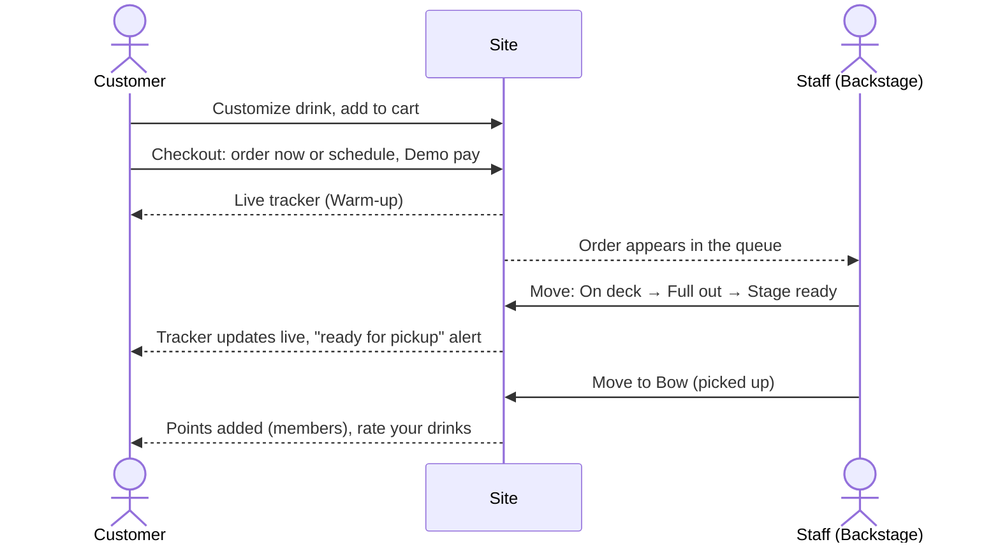
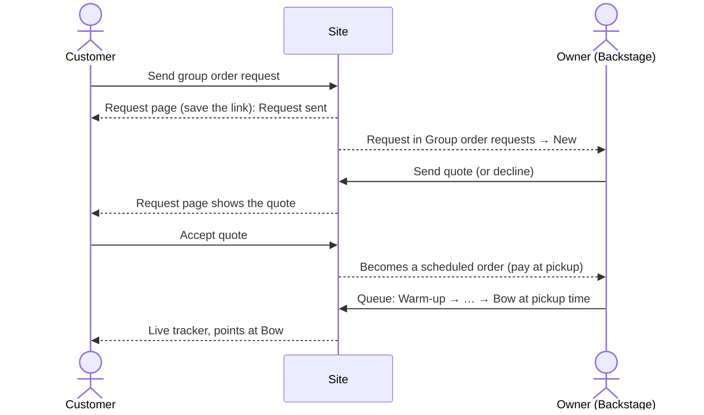

# How Groove Grounds works — a step-by-step walkthrough

Live site: **https://groove-grounds.vercel.app**

This guide follows every flow from start to finish, switching between the **customer side** and the **staff side (Backstage)** at the moment each one hands over to the other. Dance terms are used across the site; each screen is named here with its plain meaning first and the dance term after it, e.g. _Cart (Playlist)_. Flip the **Dance terms / Plain words** switch in the header at any time to see the site in plain words.

> **Concept demo.** No real orders are made and no money moves: checkout uses a simulated payment. The address, contact details and baristas are fictional.

---

## 1. Who can do what

| Role                                 | How you get it                                                                       | What you can do                                                                                                     |
| ------------------------------------ | ------------------------------------------------------------------------------------ | ------------------------------------------------------------------------------------------------------------------- |
| **Guest**                            | Just visit                                                                           | Browse, order, check out, track orders, send group order requests. No account needed.                               |
| **Member** (customer account)        | Sign up, Google, or the demo dancer                                                  | Everything a guest can, plus a profile, order history, saved drinks, loyalty points, and one-tap reorders.          |
| **Demo Backstage** (any visitor)     | Footer → **Demo Backstage**                                                          | Play staff for **your own** orders only (the ones placed from your browser): move them through each status.         |
| **Barista** (`barista` role)         | Set by the owner in Supabase                                                         | The live order queue, with every order.                                                                             |
| **Owner** (`owner` role)             | Set in Supabase                                                                      | Everything: queue, dashboard, menu, schedule, group order requests, community board.                                |

Every new account starts as a customer. Staff roles can only be set in Supabase (**Table Editor → profiles → role**), never from the site, and every staff page and action checks the role on the server.

---

## 2. The 5-minute tour (for reviewers)

1. Open the site. A short **"Learn the moves"** welcome shows the menu, the cart and the Plain words switch. Skip it or step through.
2. **Menu (The Lineup)** → pick a drink → customize it → **Add to cart (Playlist)**.
3. **Cart** → **Checkout (Showtime)** → choose **Order now (Drop-in)** → enter any name and phone → **Demo pay**.
4. You land on the **live order tracker**. Keep it open in one tab.
5. In a second tab: footer → **Demo Backstage** → move your order along. Watch the tracker in the first tab update live.
6. Sign in with **Try the demo dancer** (on Sign in) to see a full profile: points, level, saved drinks, past orders.
7. Footer → **Reset demo** clears your cart and demo orders so you can start again.

---

## 3. Accounts

All sign-in options live on **Sign in** and **Join the Crew** (top-right account icon, or the menu on phones).

| Option                         | Steps                                                                                                                         | Notes                                                                                                                            |
| ------------------------------ | ----------------------------------------------------------------------------------------------------------------------------- | -------------------------------------------------------------------------------------------------------------------------------- |
| **Sign up (Join the Crew)**    | Name, email, password, optional mobile → **Join the Crew**                                                                    | If email confirmation is on, a "Check your email" screen appears; the link signs you in.                                         |
| **Continue with Google**       | Pick your Google account → **Continue**                                                                                       | First time creates the account with your Google name; an email that already has an account signs into that same account.        |
| **Email me a sign-in link**    | Type your email → the link under **Sign in**                                                                                   | Existing members only. The email link works once.                                                                                |
| **Try the demo dancer**        | One tap                                                                                                                       | A shared account with past orders and saved drinks. Its details can't be edited.                                                 |

**What happens on sign-up:** a profile is created with the **customer** role and **50 loyalty points (Reps)** as a welcome bonus.

**Guests:** ordering never requires an account. Members just get history, points and reorders.

> Email links (sign-up confirmations and sign-in links) currently only reach the project owner's address, because the site uses Supabase's built-in email. Password, Google and demo sign-in work for everyone.

---

## 4. Ordering a drink — customer → staff → customer

### Customer: place the order

1. **Menu (The Lineup)**: filter by category (genre), search, or filter hot / iced. Drinks marked **Sold out (Sitting out)** can't be ordered.
2. **Drink page**: customize it **(Remix)**: size, hot or iced, caffeine, extra shots, milk, syrups, sweetness, toppings, ice, and a note for the barista. The price updates as you choose. Tap any **?** beside an option name for what the dance term means.
3. **Add to cart (Playlist)**. Change quantities or remove items in the cart.
4. **Checkout (Showtime)**: choose how you'll get it:
   - **Order now (Drop-in)**: ready in about 10 minutes.
   - **Schedule a pickup (Book a Class)**: pick a day and a 15-minute slot, up to 7 days ahead and at least 30 minutes from now. Each slot takes up to 6 drinks; full slots show **Slot full (Class full)**.
5. Enter a name and phone, choose GCash, card or pay at pickup (all simulated), add notes, and tap **Demo pay**. It waits about 2 seconds, then the order is placed.

   Prices are recalculated on the server at this point; the cart total was a preview.

6. You land on the **live order tracker** with your order code, pickup time and your barista's name. The page shows **Live** while it's connected.

### Staff: make the order

7. The order appears in **Backstage → Order queue**:
   - **Order now** orders appear straight away.
   - **Scheduled** orders appear 15 minutes before their pickup slot. Until then they're shown as **Upcoming**.
8. Staff tap **Move to …** to step it through the statuses:

   | Status (dance term)  | Plain meaning                 |
   | -------------------- | ----------------------------- |
   | **Warm-up**          | Order received                |
   | **On deck**          | Queued, next up               |
   | **Full out**         | Being made now                |
   | **Stage ready**      | Ready for pickup              |
   | **Bow**              | Picked up, order complete     |

   An order can also be cancelled **(Cut from the set)** before Bow. Cancelling a scheduled order frees its slot.

### Customer: pick it up

9. The tracker updates by itself at every step. At **Stage ready** it shows a "ready for pickup" alert.
10. At **Bow**:
    - **Members earn points (Reps):** 1 point per ₱10 of the order, paid once per order.
    - **Rate your order (Give Props):** each menu drink on the order gets a 1–5 star card with an optional comment. Ratings appear on that drink's page (average, count, latest comments).

**Members:** the order now shows under **Order history (Past Performances)** on the profile, with **Order again (Run it back)** to add the same items to the cart in one tap (re-priced from today's menu; anything sold out is skipped).

---

## 5. Build your own drink (Freestyle)

1. Nav → **Build your own drink (Freestyle)** → pick a base: espresso, cold brew, matcha, chocolate or tea.
2. Step through the same options as customizing, with a live cup preview and running price. Use **Back / Next**, or tap any step number to jump.
3. On the review step:
   - **Name your drink (Name your choreo)** to save it to your profile (members only).
   - **Add to cart**, then check out as in section 4.
4. Saved drinks appear under **Saved drinks (Saved Choreo)** on the profile, each with **Order again** and **Remove**.

---

## 6. Group orders (Crew Order) — customer → owner → customer → staff

### Customer: send the request

1. Nav → **Group order (Crew Order)**. Fill in:
   - **Pickup date and time:** at least 2 days ahead, at most 60 days, during opening hours.
   - **Number of people:** 10 to 200.
   - **Drinks you need** (free text), optional **budget**, name, phone, optional email, notes.
2. **Send request** opens the **request page**. Save its link; it's how you check on the request. Status: **Request sent**.

### Owner: quote it

3. **Backstage → Group order requests** (owner only). The request is under **New**.
4. Enter a **quote** (pre-filled with the customer's budget, if they gave one) and an optional note → **Send quote**. Or **Decline** (tap twice to confirm).
5. The request moves to **Awaiting customer**.

### Customer: accept

6. Back on the request page, the status is **Quote ready** with the amount and note.
7. **Accept quote** (or **Decline**). Accepting:
   - marks the request **Confirmed**;
   - **creates a real scheduled order** for the pickup time: one "Group order" line per person at the quoted total, **pay at pickup**;
   - shows **Track your order** on the request page.

### Staff: make it

8. The order appears in the **Order queue** 15 minutes before pickup, tagged **Group order at [time]** (shown as **Upcoming** before that), and on the dashboard's upcoming pickups.
9. Staff move it through the same statuses as any order. The customer's tracker updates live, and members earn points at **Bow**.

> **Demo shortcut for visitors.** Nobody is on shift to quote a visitor's request, so on **your own** new request (sent from your browser) a dashed **Concept demo** panel offers **Send myself a demo quote**. The quote is your budget, or ₱170 per person. Then accept it and move the order along in **Demo Backstage**.

---

## 7. Loyalty points and levels (Reps & Levels)

- **Earning:** 50 points for joining, plus 1 point per ₱10 on every order that reaches **Bow**.
- **Levels** go by lifetime points:

  | Level              | Points |
  | ------------------ | ------ |
  | **Rookie**         | 0      |
  | **Cypher Regular** | 200    |
  | **Battler**        | 500    |
  | **Judge**          | 1,000  |
  | **Legend**         | 2,000  |

- **Rewards** (redeemed at the counter by showing your profile, not online): a free topping (100), a free upgrade to large (150), any pastry or snack (250), any drink on the menu (400).
- See it on the profile (level bar, points to the next level) and on **Reps & Levels** (history, ladder, rewards).

---

## 8. Owner tools — what they change on the customer side

| Backstage page                    | What the owner does                                                                                                                 | What customers see                                                                                                   |
| --------------------------------- | ----------------------------------------------------------------------------------------------------------------------------------- | -------------------------------------------------------------------------------------------------------------------- |
| **Dashboard**                     | Today's orders, revenue, items sold and open orders; last 7 days; top drinks; busiest hours; upcoming scheduled and group pickups.     | (Read-only for the owner.)                                                                                           |
| **Order queue** (barista + owner) | Move orders through the statuses, or cancel.                                                                                        | Live tracker updates.                                                                                                |
| **Menu manager**                  | Edit names, descriptions and prices; add drinks; switch **Spotlight** (featured) and **Sold out (Sitting out)**; customization prices and availability. | Menu, drink pages and the home page featured drink update. Sold-out items can't be ordered.                          |
| **Pickup schedule (Class schedule)** | Opening hours, slot length, drinks per slot, how far ahead, minimum notice, closed days.                                          | Checkout's slot picker, the footer hours and Find the Studio follow these settings. Closed days disappear from booking. |
| **Group order requests**          | Quote or decline (section 6).                                                                                                       | The request page shows the quote.                                                                                    |
| **Community board (The Cypher)**  | Add, edit, hide or delete posts, each worded in dance terms and plain words.                                                        | The newest 3 visible posts show on the home page.                                                                    |

Current schedule: open daily 7:00 AM to 9:00 PM, 15-minute slots, 6 drinks per slot, booking up to 7 days ahead, at least 30 minutes' notice, no closed days.

---

## 9. Help and settings

- **Dance terms / Plain words** (header): swaps every label; remembered on your device. Drink names stay as dance styles; each shows its plain description.
- **?** next to dance-term headings (in Dance mode): the plain meaning and why the term fits.
- **Glossary (Dance Dictionary)**: every term explained, plus a note on each dance style. In the footer (**FAQ**) and the **More** menu.
- **About (The Crew)**, **Location & hours (Find the Studio)** and **Privacy**: in the **More** menu and the footer.

---

## 10. Starting over

- **Reset demo** (footer, tap twice): clears your cart and makes your browser forget its demo orders and group requests, so Demo Backstage starts empty. Orders stay in the database, so the owner's dashboard history is kept.
- **Sign out**: on your profile.

---

## 11. Limits of the demo

- **Payments are simulated.** The card form is pre-filled with fake numbers and is read-only.
- **No confirmation emails** for orders. The tracker shows the code, pickup time and status instead.
- **Email links** (sign-up confirmation, sign-in links) only reach the owner's address on the built-in email service.
- **Fictional details:** the address (88 Downbeat Street, Poblacion, Makati), phone, email, founding story and the two baristas.
- **Pickup only,** one location, no delivery.
